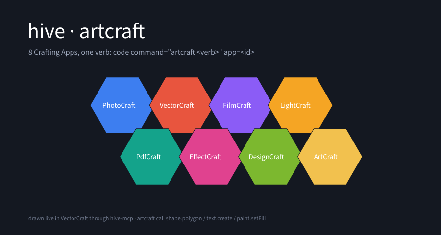
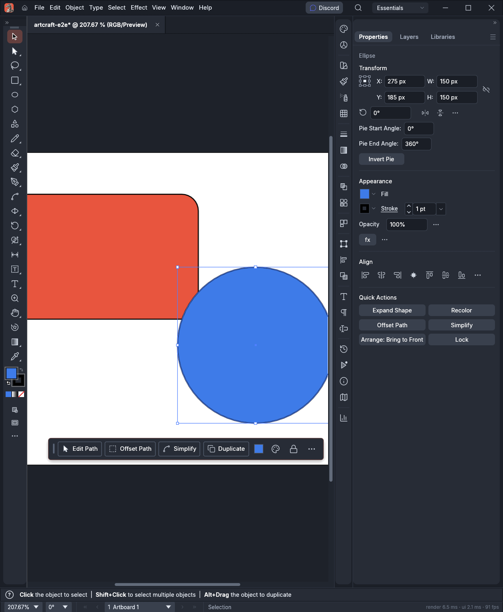
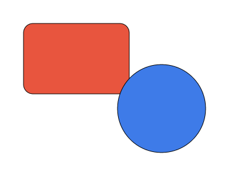
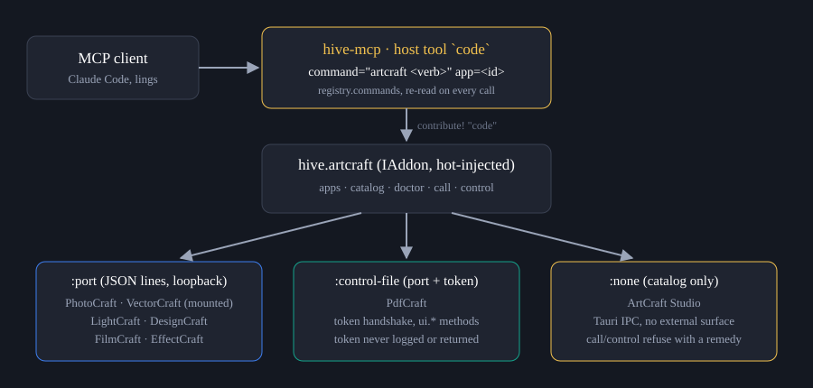

# hive-artcraft



One hive addon, `hive.artcraft`, with **one verb, `artcraft`**, for every ArtCraft "Crafting App"
(PhotoCraft, VectorCraft, LightCraft, DesignCraft, FilmCraft, EffectCraft, PdfCraft, ArtCraft Studio).
Each app is a **module**: a piece of data in a registry list. The `app` argument is an enum built
from the apps that mounted.

The image above is not a mock-up. It was drawn in a running VectorCraft, entirely through
`artcraft call` (`file.new`, `shape.polygon`, `text.create`, `paint.setFill`), and exported with
`artcraft control app.export`.

## Showcase: driving a live app

Start the app with its control channel, hot-inject the addon, and drive it from any MCP client
that is already connected:

```text
vectorcraft --control 7990                       # a real GUI window
hot inject  path=<checkout>/hive-artcraft        # no hive-mcp restart

code command="artcraft call"    app=vectorcraft engine_command=file.new        params={"name":"artcraft-e2e","width":400,"height":300}
code command="artcraft call"    app=vectorcraft engine_command=shape.rectangle params={"x":40,"y":40,"width":180,"height":120,"radius":16}
code command="artcraft call"    app=vectorcraft engine_command=paint.setFill   params={"color":"#e8553e","ids":[2]}
code command="artcraft call"    app=vectorcraft engine_command=shape.ellipse   params={"x":200,"y":110,"width":150,"height":150}
code command="artcraft control" app=vectorcraft method=ui.screenshot
code command="artcraft control" app=vectorcraft method=app.export params={"path":"…/artcraft-e2e.png","format":"png"}
```

| the window, driven over `artcraft` | the exported PNG |
|---|---|
|  |  |

## How it plugs into hive



`artcraft` is not a top-level MCP tool. `initialize!` contributes it as a subdomain of the host
`code` tool through `hive-addon.registry.commands/contribute!`, and `shutdown!` retracts it.
hive-mcp re-reads that registry on every call, so a client that connected before the addon was
injected can still call `code command="artcraft <verb>"`. A new top-level tool would stay
invisible to that client until it reconnected. The addon is meant to be hot-injected when a
creative app is in use, not loaded at hive-mcp startup.

This release mounts **photocraft** and **vectorcraft**. It depends on the published
`io.github.hive-agi/hive-photocraft` and `io.github.hive-agi/hive-vectorcraft` (0.1.1) and forwards
calls to their own tool handlers. Their code is not copied.

**lightcraft** (port 7980, `LIGHTCRAFT_CONTROL_PORT`) and **designcraft** (port 7981,
`DESIGNCRAFT_CONTROL_PORT`) are `:native :port` modules. hive-artcraft serves them from
`resources/hive_artcraft/catalogs/<app>.edn`. `dev/extract_<app>.clj` derives each catalog from a
reference clone: `clojure -M:dev -m extract-lightcraft [root]`. **pdfcraft** (`:control-file`, catalog
from `clojure -M:dev -m extract-pdfcraft [root]`) and **studio**, ArtCraft itself (`:none`, catalog-only,
from `clojure -M:dev -m extract-studio [root]`) are native too. It uses the shared parser in
`dev/artcraft_extract.clj`, which is ported from hive-vectorcraft and also reads DesignCraft's
`noundo` arm. `:reference-revision` is the clone's HEAD sha.

## Using it

Every call goes through the host `code` tool:

```json
{"command":"artcraft apps"}
{"command":"artcraft catalog","app":"vectorcraft"}
{"command":"artcraft catalog","app":"vectorcraft","query":"control"}
{"command":"artcraft doctor","app":"vectorcraft"}
{"command":"artcraft call","app":"vectorcraft","engine_command":"shape.rectangle","params":{"x":0,"y":0,"width":10,"height":10}}
{"command":"artcraft control","app":"photocraft","method":"ui.inspect"}
```

| arg | meaning |
|---|---|
| `app` | mounted app id (`command="artcraft apps"` lists them) |
| `command` | `artcraft apps` \| `artcraft catalog` \| `artcraft doctor` \| `artcraft call` \| `artcraft control` |
| `query` | catalog section (`engine`, `mcp`, `control`) or one exact command id |
| `engine_command`, `method`, `params`, `id` | passed through to the app |

`params` may also arrive as JSON text. A client that still holds the `code` schema from before
`artcraft` was contributed sends it that way, and it is decoded when it parses to a JSON object.

`artcraft catalog app=vectorcraft` returns exactly what hive-vectorcraft's own `vectorcraft` tool
returns (519 engine commands, 25 MCP tools, 24 control methods at revision 65c5953). A test checks this.

### Configuration

```clojure
;; hive-mcp config.edn
:addons {"hive.artcraft" {:apps {"vectorcraft" {:control-port 7979}
                                 "photocraft"  {:control-port 7878
                                                :token-ref {:scheme :env :name "PHOTOCRAFT_CONTROL_TOKEN"}}}}}
```

Each app's control port is chosen in this order:

1. `:apps {"<app>" {:control-port N}}`
2. the `<APP>_CONTROL_PORT` environment variable
3. the module's default

The default ports are 7878 (photocraft), 7979 (vectorcraft), 7980 (lightcraft), 7981 (designcraft),
9876 (filmcraft) and 9877 (effectcraft). They never collide.

PhotoCraft authenticates its control channel, so it only gets a port when a `:token-ref` is also
configured. Without one, its calls refuse with the fix instead of failing on the socket. Keep every
control port on loopback.

#### FilmCraft: control token

FilmCraft's `--control` port only listens when `FILMCRAFT_CONTROL_TOKEN` (64 hex characters) is set,
and every request must carry that value as a top-level `"token"`. Otherwise the app replies with an
auth error and closes the connection. Launch it with a fresh token:

```sh
export FILMCRAFT_CONTROL_TOKEN="$(python3 -c 'import secrets;print(secrets.token_hex(32))')"
filmcraft --control 9876
```

The filmcraft module defaults to `:token-ref {:scheme :env :name "FILMCRAFT_CONTROL_TOKEN"}`, so a hive
JVM started from a shell holding the same export needs no config. Otherwise, keep the token in a file
only you can read (regular file, mode 600, not a symlink) and point hive at it:

```clojure
:addons {"hive.artcraft" {:apps {"filmcraft" {:control-port 9876
                                              :token-ref {:scheme :file :path "/home/me/.private/filmcraft-control.token"}}}}}
```

The token is read on every request, so a token exported or rotated later is picked up without a
restart. It is never logged, returned or put in an error, and any echo of it in a reply is replaced
by `<redacted>`. `artcraft doctor app=filmcraft` reports `:token {:status ...}`; when no token
resolves, it shows the fix. Apps without a `:token-ref` are sent the request exactly as before.

## Adding a Crafting App

An app is **one module map** appended to `resources/hive_artcraft/apps.edn`. A `:native` app also
needs **one catalog resource**. Neither the shared code nor the tool schema changes: the `app` enum,
`apps`, `doctor` and the routing all come from the registry. Every classpath copy of
`hive_artcraft/apps.edn` is concatenated, so another jar can contribute apps as well.

### The contract (`hive-artcraft.schema/AppModule`, Malli-validated at load)

| key | required | meaning |
|---|---|---|
| `:app/id` | yes | lowercase id, the value of `app` (`"lightcraft"`) |
| `:app/label`, `:app/summary` | yes | shown by `command=apps` |
| `:app/kind` | yes | `:mount` (forward to an existing hive addon) or `:native` (served here) |
| `:app/transport` | yes | transport shape, see below |
| `:app/default-port` | for `:port` | default control port |
| `:app/port-env` | for `:port` | env override, `<APP>_CONTROL_PORT` |
| `:app/catalog-resource` | for `:native` | classpath EDN satisfying `schema/Catalog` |
| `:app/mount` | for `:mount` | `{:ctor ns/addon-ctor :addon-id "hive.x" :port-requires [:token-ref]}` |
| `:app/token-ref` | no (`:native` `:port` only) | default token reference `{:scheme :env :name "<APP>_CONTROL_TOKEN"}` or `{:scheme :file :path ...}` for a port that authenticates every request (filmcraft); `:apps {"<app>" {:token-ref ...}}` overrides it |
| `:app/upstream` | no | upstream repository URL |

Per-app runtime config (`schema/AppConfig`, under `:apps {"<id>" {...}}`) accepts:
`:control-port`, `:control-host`, `:control-file`, `:token-ref` and `:transport`. An injected
`ControlTransport` always wins.

If a module is invalid or an id is duplicated, the addon refuses to initialize and names the
module and the reason.

### Transport shapes

| shape | apps | behaviour |
|---|---|---|
| `:port` | vectorcraft, lightcraft, designcraft, filmcraft, effectcraft (photocraft adds a token) | **live**: `<app> --control PORT`, one JSON line `{id, method:"engine.execute", params:{command, params}}` per request, over loopback (`hive-artcraft.transport.socket`). An app with a `:token-ref` (filmcraft) also gets a top-level `"token"` on each line |
| `:control-file` | pdfcraft | **live** once `:apps {"pdfcraft" {:control-file "~/.pdfcraft-control.json"}}` is set: `pdfcraft --control <FILE>` listens on a random loopback port and writes `{port, token}` to FILE. Each request re-reads the file (it must be a regular file you own, mode 600, not a symlink, under 64 KiB), sends JSON-RPC `auth {token}` first, then one `ui.*` request (`hive-artcraft.transport.control-file`). `call` maps `engine_command` to `ui.command {id}`, and `control` sends catalogued `ui.*` methods (`ui.commands`, `ui.inspect`, `ui.state`...). The token is never logged or returned: it prints as `#<redacted>`. Without `:control-file`, calls refuse with `:artcraft/no-transport` |
| `:none` | studio (ArtCraft, Tauri IPC) | catalog only (its `#[tauri::command]` fns); doctor reports `:status :no-control-surface` with a remedy; `call`/`control` refuse with `:artcraft/unsupported-shape` |

`doctor` always reports the app's shape, its resolved port and its source (`:config`, `:env` or
`:default`), whether a transport is ready, and the remedy.

### Example: a native `:port` app

```clojure
;; resources/hive_artcraft/apps.edn — append:
{:app/id "lightcraft"
 :app/label "LightCraft"
 :app/summary "Photo library and raw development."
 :app/kind :native
 :app/transport :port
 :app/default-port 7980
 :app/port-env "LIGHTCRAFT_CONTROL_PORT"
 :app/catalog-resource "hive_artcraft/catalogs/lightcraft.edn"
 :app/upstream "https://github.com/storytold/lightcraft"}
```

`resources/hive_artcraft/catalogs/lightcraft.edn` holds the extracted vocabulary:

```clojure
{:reference-revision "fb7ac08"
 :engine [{:id "develop.exposure" :label "Exposure"} ...]
 :mcp [{:name "..."} ...]
 :control ["engine.execute" "engine.commands" "ui.render" ...]}
```

That's it. `call` checks `engine_command` against `:engine`, `control` checks `method` against
`:control`, and both go out over the resolved port.

### Example: mounting an existing hive addon

```clojure
{:app/id "vectorcraft" :app/label "VectorCraft" :app/summary "..."
 :app/kind :mount :app/transport :port
 :app/default-port 7979 :app/port-env "VECTORCRAFT_CONTROL_PORT"
 :app/mount {:ctor hive-vectorcraft.addon/addon-ctor :addon-id "hive.vectorcraft"}}
```

The delegate's manifest ctor receives its `:apps` config with the resolved `:control-port`. It is
initialized once, and every command (minus `app`) goes to its tool handler unchanged. Add the
delegate's library to `deps.edn`.

## Layout

| ns | role |
|---|---|
| `hive-artcraft.schema` | `AppModule`, `AppConfig`, `TransportShape`, `Catalog` contracts |
| `hive-artcraft.registry` | reads and validates the app data list, resolves per-app config and ports |
| `hive-artcraft.mount` | constructs a delegate addon and forwards to its tool |
| `hive-artcraft.service` | native-app catalog/doctor/call/control for each shape |
| `hive-artcraft.core` (.cljc) | portable request/frame/reply values |
| `hive-artcraft.port`, `.transport.socket` | `ControlTransport` port and loopback JSON-lines client |
| `hive-artcraft.addon` | the IAddon and the `artcraft` tool |

## Tests

```sh
clojure -M:test
```

The suite covers every public function with a golden, property and mutation trifecta (a gate test
reads the universe from `src/`), every one has a Malli contract (also census-checked), and there are
acceptance tests against the real photocraft and vectorcraft delegates.

MIT licensed.
